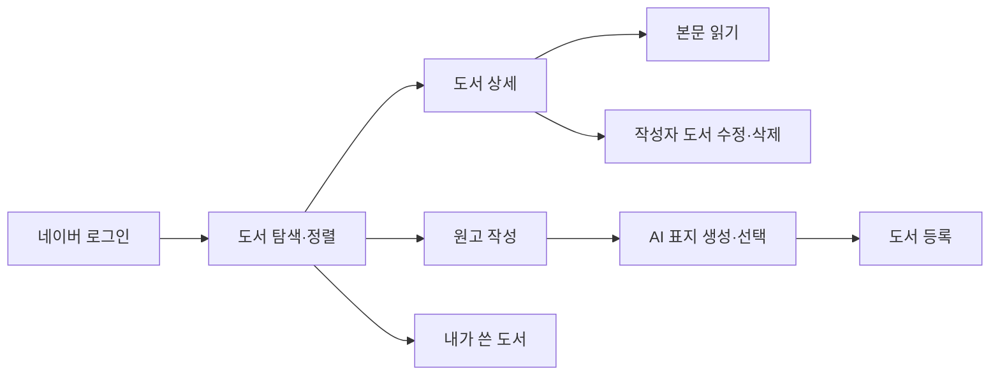

# 모두의 서재 · Frontend

**글 작성 → AI 표지 선택 → 도서 공개를 연결하는 React 창작 플랫폼**

독자는 카드형 목록에서 작품을 찾고 본문을 읽습니다. 작가는 원고와 소개를 작성하고 표지를 선택해 도서를 등록합니다.
이 저장소는 KT AIVLE 팀 프로젝트를 바탕으로 김건우가 API 연결과 사용자 흐름을 발전시킨 개인 포트폴리오입니다.

[Backend](https://github.com/withoutsultang/aivle-library-backend) · [개인 기여](docs/CONTRIBUTIONS.md) · [화면 흐름](docs/ARCHITECTURE.md) · [실행](docs/RUNNING.md) · [검증](docs/VERIFICATION.md)

## 사용자 흐름



## 구현 포인트

|기능|사용자에게 제공하는 경험|코드|
|---|---|---|
|도서 탐색|페이지별 카드 목록과 최신·인기·제목 정렬|[BookList](src/pages/BookList.jsx)|
|작품 읽기|기본 정보·소개·본문을 나누고 800자 단위로 본문 탐색|[BookDetail](src/pages/BookDetail.jsx) · [BookBody](src/pages/BookBody.jsx)|
|원고 작성|등록·수정을 한 폼으로 관리, 직접 수정 URL 접근 시 도서 복원|[BookReg](src/pages/BookReg.jsx)|
|표지 선택|설명·카테고리를 이미지 요청에 연결하고 최근 3개 후보에서 선택|[BookReg](src/pages/BookReg.jsx)|
|인증 흐름|OAuth 토큰 처리, 사용자 조회, 보호된 경로와 작성자 버튼 표시|[App](src/App.jsx) · [사용자 상태](src/store/UserContext.jsx)|

## 김건우의 기여

팀 프로젝트에서 **Vite proxy·API 연결 환경 조정과 이미지 생성 모델·해상도 요청 설정 변경**에 참여했습니다.
도서 API·Validation·JWT·배포 연동을 맡은 백엔드와 함께, 클라이언트부터 API까지 이어지는 흐름을 다뤘습니다.

개인 공개본에서는 다음 개선을 직접 반영했습니다.

- 수정 화면의 새로고침·직접 접근을 지원하고 저장 후 상세 경로로 연결
- 등록·수정에 공통 인증 API 클라이언트 적용
- 사용자 ID 기반 작성자 버튼 표시, 안정적인 사용자 Context와 요청 취소 처리
- 이미지 로드 실패 시 대체 표지 표시와 새 URL 재시도
- 서버 API를 통한 AI 표지 생성과 세로·정사각·가로 비율 선택
- 페이지별 지연 로딩으로 메인 JavaScript 청크 **약 47.2% 축소** — [빌드 비교](docs/VERIFICATION.md)
- 화면 회귀 테스트·ESLint·프로덕션 빌드를 CI로 연결

화면 전체와 초기 컴포넌트는 팀의 공동 결과물이며, 본인의 변경 근거는 [기여 문서](docs/CONTRIBUTIONS.md)에 정리했습니다.

## 기술 스택

**React 19 · JavaScript · React Router 7 · MUI 7 · Emotion · Axios · Vite 7 · Vitest · Testing Library · ESLint**

## 빠른 시작

Node.js 22.12 이상을 사용합니다.

```bash
git clone https://github.com/withoutsultang/aivle-library-frontend.git
cd aivle-library-frontend
npm ci
npm run dev
```

개발 서버는 `/api/v1`을 `http://localhost:8080`의 백엔드로 전달합니다.
로그인·도서 저장에는 [백엔드 환경](https://github.com/withoutsultang/aivle-library-backend)이 필요하며, 표지 생성은 백엔드가 서버에 설정된 API 키로 요청합니다.

```bash
npm run lint
npm test
npm run build
```

## 탐색 가이드

- [개인 기여와 커밋 근거](docs/CONTRIBUTIONS.md)
- [라우팅·상태·API 설계](docs/ARCHITECTURE.md)
- [환경 설정·실행](docs/RUNNING.md)
- [테스트·빌드 검증](docs/VERIFICATION.md)
- [제3자 자료와 출처](docs/THIRD_PARTY.md)

**김건우 · [GitHub](https://github.com/withoutsultang)** | KT AIVLE 팀 프로젝트 기반 개인 포트폴리오
