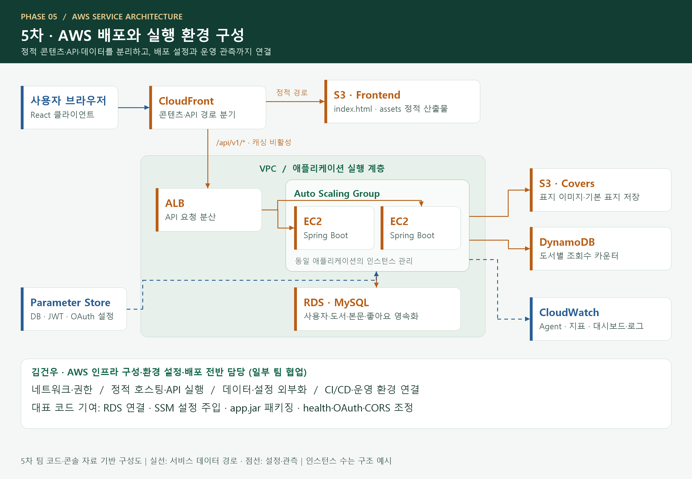

# 화면과 상태 설계

## 4차 개발 → 5차 AWS 확장

4차는 React·Spring Boot·H2 기반 로컬 개발, 5차는 AWS 배포·환경 구성에 초점을 맞춘 프로젝트입니다. 김건우는 4차 백엔드 API와 인증/인가 개선, 5차 AWS 인프라·환경 설정·배포 전반을 담당했고 일부 작업은 팀원과 공동 수행했습니다.

AWS의 서비스별 역할·배포 경로·작성 근거는 [AWS_DEPLOYMENT.md](AWS_DEPLOYMENT.md)에 정리했습니다. 아래 애플리케이션 설계는 현재 개인 공개본을 기준으로 설명합니다.

## 라우팅

|경로|화면|
|---|---|
|`/login`|네이버 로그인|
|`/oauth/success`|토큰 수신·사용자 조회|
|`/booklist`|카드 목록·정렬·페이지 이동|
|`/detail/:id`|도서 정보·소개·수정/삭제|
|`/body`|800자 단위 본문 리더|
|`/bookreg`, `/bookreg/:id`|등록·수정 공통 폼|
|`/mypage`|내가 등록한 도서|

페이지는 React.lazy와 Suspense로 필요한 시점에 로드합니다. 수정 화면은 URL의 ID로 메타데이터와 본문을 조회해 직접 접근과 새로고침에도 원고를 복원합니다.

## 인증과 데이터 흐름

sessionStorage의 토큰을 공통 Axios 요청에 연결합니다. UserProvider는 사용자 정보와 안정적인 setter를 제공하고, 작성자 버튼은 userId로 판별합니다. 실제 수정·삭제 권한은 백엔드에서 검증합니다.

상세·수정 화면은 AbortController로 화면 전환 후의 요청을 정리합니다. BookCover는 이미지 로드 실패 시 대체 표지를 표시하고 새로운 URL을 받으면 다시 시도합니다.

## 도서 작성과 AI 표지

제목·분류·소개·본문을 공통 폼에서 작성합니다. AI 팝업은 설명의 주제와 카테고리를 프롬프트에 연결하고 최근 3개 후보를 유지합니다. 선택한 표지 URL과 원고를 API로 전송합니다. 저장 중 중복 제출을 방지하고 저장 후 도서 상세로 이동합니다.

## 서버 기반 이미지 생성

인증된 사용자의 표지 요청은 `/api/v1/covers/generate`로 전달합니다. 백엔드는 서버 환경변수 `OPENAI_API_KEY`로 Images API를 호출하고 PNG Base64 결과를 반환합니다. 사용자가 선택한 표지는 PNG signature와 크기를 검사한 뒤 S3 key로 저장합니다. 모델은 `IMAGE_MODEL`로 설정하며 기본값은 `gpt-image-2.5-sunburst`입니다. 표준 크기는 `1024x1024`, `1024x1536`, `1536x1024`입니다.

기준: [OpenAI Images API 공식 문서](https://developers.openai.com/api/reference/resources/images/methods/generate), 2026-10-29 확인. 테스트는 API 계약과 데이터 처리를 검증하며 실제 유료 생성 요청은 실행하지 않습니다.
