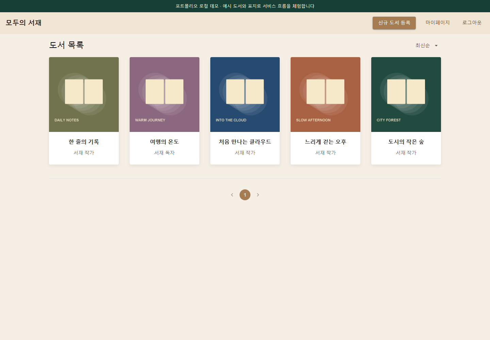
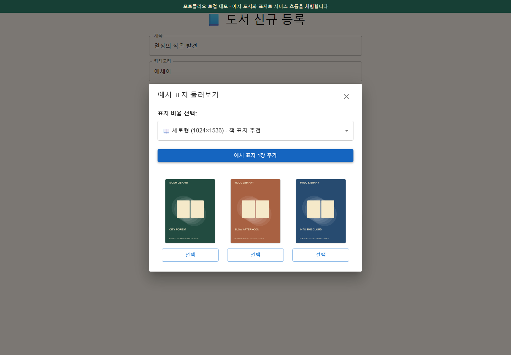
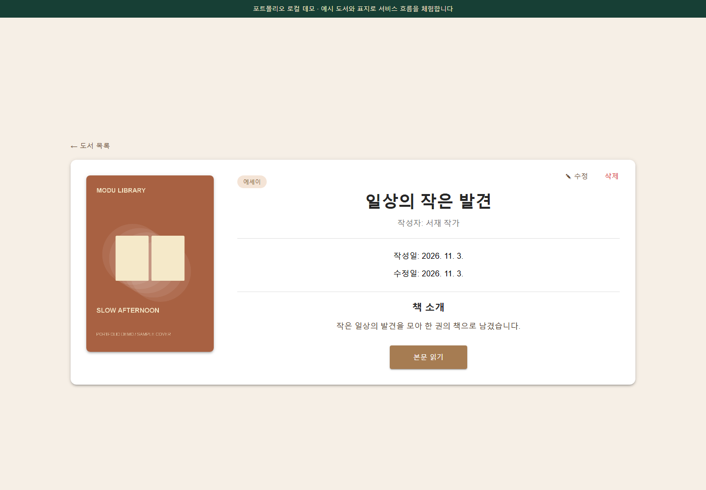
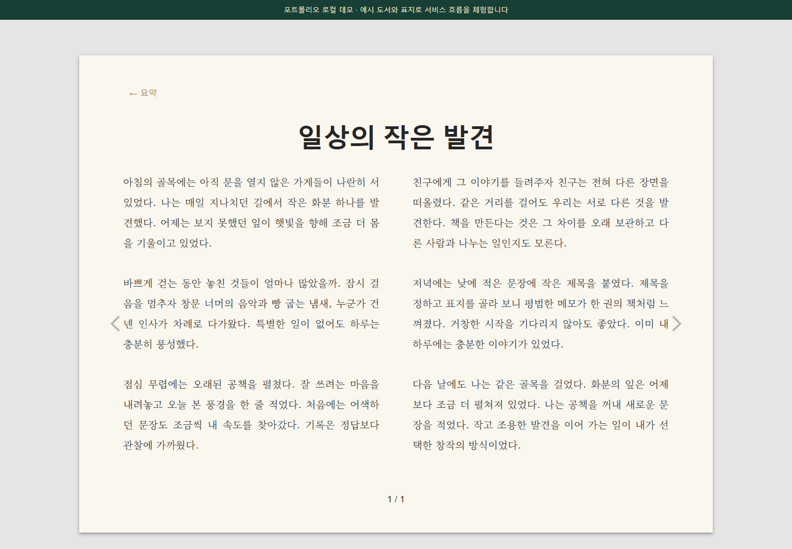

# 모두의 서재 · 화면 시연과 전체 흐름 검증

**2026-11-03 · 현재 개인 공개본을 로컬에서 실행해 촬영했습니다.** React 화면·Spring REST API·JWT/작성자 인가·JPA·H2 SQL 저장을 실제로 연결합니다. 예시 계정·표지·도서를 사용하며, 네이버 로그인·OpenAI·AWS 호출은 로컬 데모 어댑터로 대체합니다.

## 짧은 시연


[MP4 시연 영상](assets/demo/showcase.mp4) · [WebM 원본 녹화](assets/demo/showcase.webm)

서재 진입 → 도서 탐색 → 원고 작성 → 예시 표지 선택 → 도서 등록 → 본문 읽기 → 원고 수정 순서입니다. 녹화 스크립트에서도 등록·수정 후 SQL 행을 조회해 저장 결과를 확인합니다.

## 대표 화면

|도서 탐색|표지 후보 선택|
|---|---|
|||

|도서 상세|본문 읽기|
|---|---|
|||

[진입 화면](assets/demo/01-login.png) · [원고 작성](assets/demo/04-manuscript.png) · [수정 결과](assets/demo/07-revised.png) · [공개된 목록](assets/demo/08-published-library.png)

캡처는 브라우저가 렌더링한 원본 PNG입니다. MP4와 GIF는 같은 실제 WebM 녹화에서 변환했으며, 합성한 성공 화면을 넣지 않았습니다. 이 자료는 2026년 공개본의 로컬 재현이고 과거 4·5차 운영 화면과 구분합니다. [파일 해시·촬영 범위](assets/demo/manifest.json)

## 실행해 보기

Java 17과 Node.js 22.12 이상을 준비합니다. 두 저장소를 나란히 배치합니다.

```bash
git clone https://github.com/withoutsultang/aivle-library-backend.git backend
git clone https://github.com/withoutsultang/aivle-library-frontend.git frontend
```

첫 터미널:

```bash
cd backend
./gradlew demoRun
```

Windows는 `.\gradlew.bat demoRun`을 사용합니다. 서버는 `127.0.0.1:18080`에만 바인딩되며 예시 데이터를 메모리 SQL DB에 준비합니다.

두 번째 터미널:

```bash
cd frontend
npm ci
npm run dev:demo
```

브라우저에서 `http://127.0.0.1:15173`에 접속해 **데모 서재 둘러보기**를 누릅니다. AWS 자격증명·외부 로그인·유료 이미지 생성 없이 흐름을 체험할 수 있습니다. 서버 종료 시 예시 데이터는 사라집니다.

## 브라우저 통합 테스트

수동 데모 서버를 종료한 뒤 프론트 저장소에서 실행합니다. 테스트가 별도의 백엔드와 데모용 프론트 빌드를 자동 시작·종료합니다.

```bash
npm ci
npx playwright install chromium
npm run test:e2e
```

Linux에서는 최초 브라우저 준비에 `npx playwright install --with-deps chromium`을 사용합니다. 백엔드 폴더가 다른 위치면 `BACKEND_DIR`로 경로를 지정합니다. 기본으로 이웃한 `backend` 또는 `aivle-library-backend`를 찾습니다. 이미 의존성을 준비한 환경은 `GRADLE_OFFLINE=1`을 선택할 수 있습니다.

|시나리오|확인하는 실제 동작|
|---|---|
|등록|화면 입력 → POST HTTP 201 → books·book_details SQL 행 → 새로고침 후 조회·표지 로드|
|수정|직접 수정 URL·새로고침 → PUT → SQL 본문 변경·기존 표지 key 유지|
|본문 읽기|실제 저장된 1,600자를 800자씩 두 페이지로 탐색|
|작성자 권한|다른 사용자의 수정 403·SQL 원문 유지·화면의 수정/삭제 메뉴 숨김|
|인증·입력 검증|잘못된 Bearer 401·빈 제목 400·DB 원문 유지|
|삭제|화면 확인 → DELETE → SQL 행 삭제·목록 제외|

CRUD 응답을 브라우저에서 가로채 만들어 주지 않습니다. API가 처리한 결과를 데모 전용 읽기 전용 SQL 관측 경로로 별도 확인합니다. 브라우저에서 로컬 주소 이외의 요청은 차단합니다.

[6개 시나리오 실행 결과](evidence/e2e-summary.json) · [Full-stack E2E CI](https://github.com/withoutsultang/aivle-library-frontend/actions/workflows/full-stack.yml)

CI는 두 공개 저장소를 체크아웃하고 검사한 백엔드 SHA를 로그에 남깁니다. 백엔드만 변경했을 때도 위 workflow의 수동 실행으로 현재 두 저장소의 연결을 확인할 수 있습니다. HTML 보고서와 실패 화면은 CI artifact로 7일간 보관합니다.

## 화면 자료 다시 만들기

```bash
npm run demo:record
python -m pip install imageio-ffmpeg==0.6.0
python scripts/export-preview.py
```

성공한 시연 실행만 WebM 원본과 8개 화면을 `docs/assets/demo`에 기록합니다. GIF·MP4 변환은 별도 단계입니다. 이 기능은 본인의 새 실습 환경에서 수행합니다.

## 운영용 빌드와 분리

- 백엔드 데모 계정·표지 어댑터·SQL 관측 경로는 `src/demo`에 있으며 운영 `bootJar`에 포함되지 않습니다. `verifyProductionJar`로 검사합니다.
- 프론트의 데모 진입·표지 UI는 Vite `demo` 모드에서만 활성화합니다. 정상 `npm run build` 후 `npm run verify:production`으로 제거를 확인합니다.
- 로컬 데모·H2 검증은 외부 네이버 OAuth, OpenAI 이미지 생성, AWS RDS·S3·DynamoDB 운영 환경 검증과 구분합니다.
